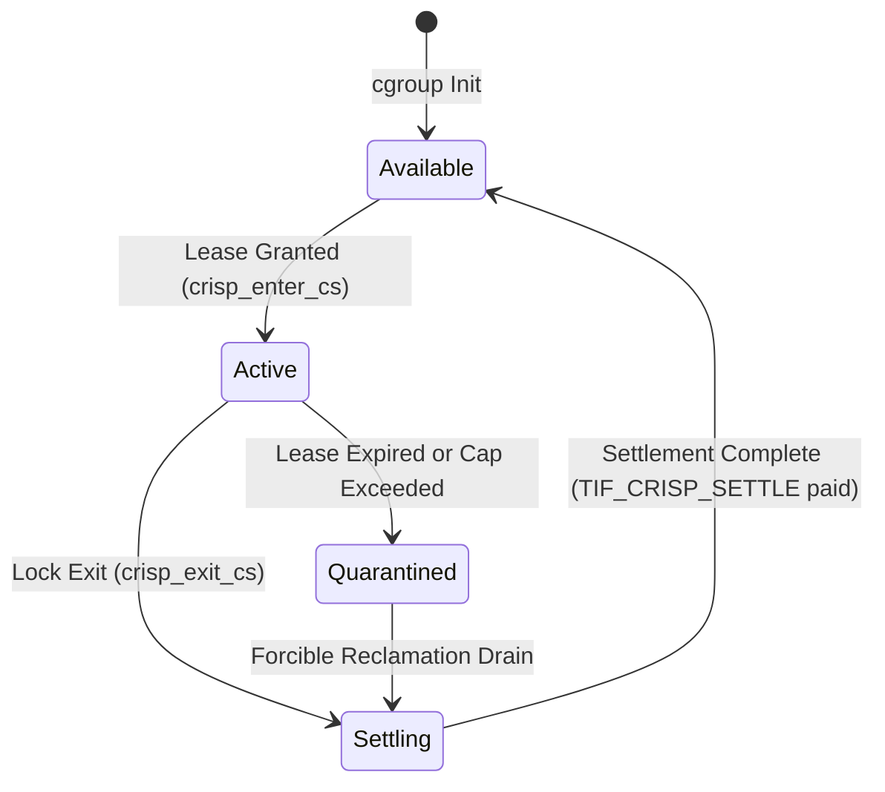
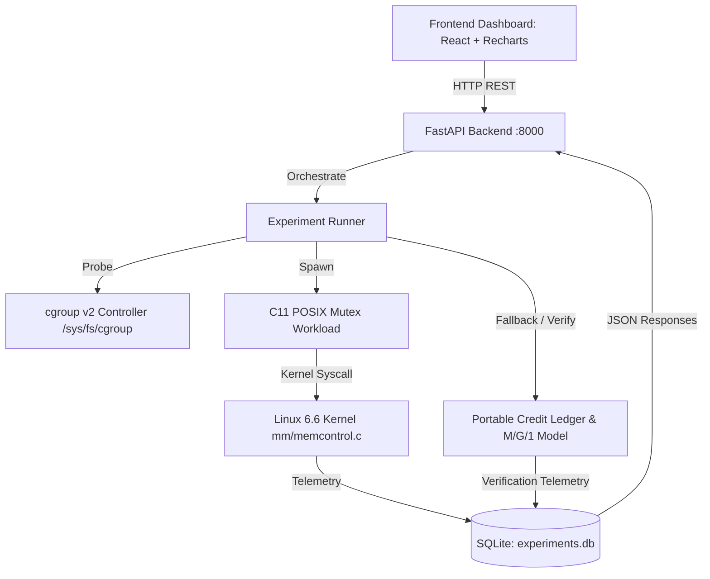

# CRISP-L: System Architecture and Kernel Boundary Specification

## 1. Executive Overview

CRISP-L (**C**ritical-Section-Aware **R**eclaim and **I**solated **S**tall **P**ostponement for **L**inux) is an operating systems research framework designed to eliminate multi-threaded lock convoys induced by asynchronous memory throttling in Linux cgroup v2. 

Under the stock Linux 6.6 memory controller (`mm/memcontrol.c`), when a cgroup exceeds its `memory.high` threshold, threads allocating memory within that cgroup are penalized with proportional sleep delays calculated via:

$$T = \min\left(2000, 64 \cdot \rho^2 \cdot \frac{n}{B}\right) \text{ ms}$$

If an allocating thread happens to be holding a user-space mutual exclusion primitive (e.g. `pthread_mutex_t`), this proportional sleep stall occurs inside the critical section. All other threads attempting to acquire the lock become blocked in the kernel futex queue, cascading into an artificial lock convoy that degrades tail latency ($p99$) by up to $179\times$.

CRISP-L introduces a bounded, leased credit-deferral mechanism that safely postpones the sleep penalty until the critical section has completed, paying the accrued debt at return-to-userland boundary.

```
+-----------------------------------------------------------------------------------------+
|                                    USER SPACE (Ring 3)                                  |
|                                                                                         |
|  +-----------------------------------------------------------------------------------+  |
|  | Multi-Threaded Application / C Workload (pthread_mutex_t)                         |  |
|  |                                                                                   |  |
|  |   1. crisp_enter_cs(flag_addr, lease_ns, debt_cap)                                |  |
|  |   2. Lock held -> Critical Section Allocation                                     |  |
|  |   3. pthread_mutex_unlock()                                                       |  |
|  |   4. crisp_exit_cs() -> settle deferred debt                                      |  |
|  +-----------------------------------------------------------------------------------+  |
|                                         |                                               |
|                    prctl(PR_SET_CRISP_LEASE, &lease_cfg)                                |
|                                         v                                               |
+-----------------------------------------------------------------------------------------+
|                                   KERNEL SPACE (Ring 0)                                 |
|                                                                                         |
|  +-------------------------------------+     +---------------------------------------+  |
|  | include/linux/sched.h               |     | mm/memcontrol.c: mem_cgroup_handle_over() |
|  | struct task_struct {                |     |                                       |  |
|  |   u64 crisp_cs_flag_addr;           |     |   if (task->crisp_active) {           |  |
|  |   u64 crisp_lease_deadline;         |     |     if (now < deadline &&             |  |
|  |   u32 crisp_accumulated_debt_ms;    |---->|         debt + stall <= d_max) {      |  |
|  |   u32 crisp_debt_cap_ms;            |     |       // Grant Deferral Lease         |  |
|  |   u8  crisp_quarantined;            |     |       task->crisp_accumulated_debt++; |  |
|  | }                                   |     |       return 0; // Bypass stall       |  |
|  +-------------------------------------+     |     }                                 |  |
|                                              |   }                                   |  |
|                                              |   // Normal stock penalty stall       |  |
|                                              |   schedule_timeout_killable(delay);   |  |
|                                              +---------------------------------------+  |
|                                                                                         |
|  +-----------------------------------------------------------------------------------+  |
|  | Return to Userland Boundary: arch/x86/entry/common.c -> crisp_settle_obligations()|  |
|  |   while (task->crisp_accumulated_debt_ms > 0) {                                   |  |
|  |     u32 slice = min(task->crisp_accumulated_debt_ms, 20);                         |  |
|  |     schedule_timeout_killable(msecs_to_jiffies(slice));                           |  |
|  |     task->crisp_accumulated_debt_ms -= slice;                                     |  |
|  |   }                                                                               |  |
|  +-----------------------------------------------------------------------------------+  |
+-----------------------------------------------------------------------------------------+
```

---

## 2. Kernel Hook Points and Boundary Specification

### 2.1 Task Control Block Additions (`include/linux/sched.h`)
CRISP-L adds 5 lightweight fields directly to `struct task_struct`:
- `crisp_cs_flag_addr`: Virtual address of the user-space lock flag (read via `get_user_pages_fast()` or `copy_from_user()`).
- `crisp_lease_deadline`: `ktime_t` timestamp bounding the maximum duration of deferral.
- `crisp_accumulated_debt_ms`: Unpaid deferred sleep penalty in milliseconds.
- `crisp_debt_cap_ms`: Per-task cap ($d_{\max}$, default 200 ms).
- `crisp_quarantined`: Single-byte boolean set if an allocation exceeds memory safety limits.

### 2.2 Memory Cgroup Hook (`mm/memcontrol.c`)
The hook is inserted inside `mem_cgroup_handle_over_high()`:
1. Verify if `task->crisp_cs_flag_addr` is registered.
2. Probe user-space flag via zero-copy safe read. If 0 (lock released), skip deferral.
3. Validate time lease: `ktime_get() < task->crisp_lease_deadline`.
4. Validate debt cap: `task->crisp_accumulated_debt_ms + penalty_ms <= task->crisp_debt_cap_ms`.
5. If all 3 gates pass, credit the debt to `crisp_accumulated_debt_ms`, record a tracepoint event `trace_crisp_deferral_granted`, and bypass `schedule_timeout_killable()`.
6. If any gate fails, immediately fall back to stock behavior.

### 2.3 Return-to-Userland Settlement (`arch/x86/entry/common.c`)
Before restoring user registers and executing `SYSRET`/`IRET`:
- Check `test_thread_flag(TIF_CRISP_SETTLE)`.
- If set, invoke `crisp_settle_obligations()`.
- Debt is repaid in bounded chunks (maximum 20ms per slice) while permitting signal delivery.
- Once repaid, clear `TIF_CRISP_SETTLE`.

---

## 3. The 4-State Credit Accounting Ledger

To maintain formal verification guarantees, CRISP-L models all memory throttling debt as a closed conservation system governed by Invariant P2:

$$\text{Capacity}_{\text{total}} = \text{Available} + \text{Active} + \text{Settling} + \text{Quarantined}$$



- **Available**: Credit pool uncommitted to any critical section.
- **Active**: Credits committed to threads currently executing within an active critical section lease.
- **Settling**: Debt committed to repayment queue outside critical section.
- **Quarantined**: Stalled allocations that breached lease or cap, preventing malicious evasion.

---

## 4. Subsystem Interactions



1. **Presentation Layer**: React 19 + TypeScript dashboard rendering live execution graphs, interactive architecture diagrams, Recharts analytics, and stacking portfolio cards.
2. **Backend API Layer**: FastAPI service providing allowlisted benchmark execution, health preflight checks, and statistical confidence intervals.
3. **Execution Layer**: Dual-mode engine that runs real Linux C binaries under native cgroups v2 when available, or executes the deterministic Python 4-state credit ledger model with full provenance tagging.
