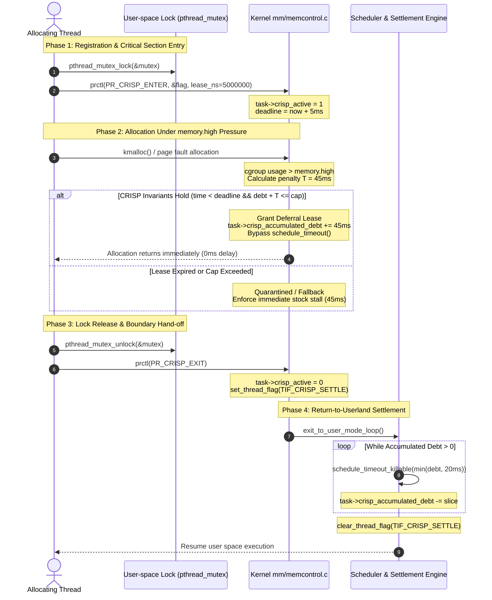

# CRISP-L: Execution Lifecycle, Event Sources, and State Transitions

## 1. Thread Execution Lifecycle

The CRISP-L deferral lifecycle coordinates user-space critical sections, kernel-space memory allocation hooks, and return-to-userland debt repayment.

---

## 2. Telemetry and Event Sources

CRISP-L sources telemetry across three distinct operational layers:

### 2.1 Kernel Tracepoints (`/sys/kernel/tracing/events/crisp/`)
When running on patched Linux kernels, low-overhead tracepoints capture microsecond-level events:
- `crisp_deferral_granted`: Emitted when an allocation avoids a `memory.high` sleep. Contains `task_id`, `requested_pages`, `deferred_ms`, `current_debt`.
- `crisp_lease_expired`: Emitted when an allocating thread exceeds its lease window without releasing the lock.
- `crisp_cap_saturated`: Emitted when a thread reaches its per-task debt cap ($d_{\max}$).
- `crisp_settlement_slice`: Emitted as chunks of deferred sleep are paid off in `arch/x86/entry/common.c`.

### 2.2 User-space Benchmark Telemetry (`linux/workload/mutex_alloc_workload.c`)
- High-resolution `clock_gettime(CLOCK_MONOTONIC_RAW)` timing at 4 critical sample points:
  1. `t_req`: Time lock acquisition was requested.
  2. `t_acq`: Time lock was acquired (`t_acq - t_req` = lock wait latency).
  3. `t_alloc`: Time taken by memory allocations inside the critical section.
  4. `t_rel`: Time lock was released (`t_rel - t_acq` = hold duration).
- Aggregated percentile generation ($p50, p95, p99, p99.9$) using reservoir sampling.

### 2.3 Simulated / Replay Telemetry
- Used in the web interface and for systems without root cgroups access.
- Generated via `model/accounting/credit_ledger.py` and calibrated against real QEMU 6.6 benchmark traces.
- Explicitly badged with `SIMULATION — NOT LIVE KERNEL DATA` to preserve scientific integrity.

---

## 3. State Machine Transitions

| Current State | Trigger Event | Guard Condition | Next State | Action |
| :--- | :--- | :--- | :--- | :--- |
| **Available** | `crisp_enter_cs` | Thread holds valid lock pointer | **Active** | Start lease timer ($t_{\text{deadline}} = t_0 + \tau$) |
| **Active** | `mem_cgroup_handle_over` | $t < t_{\text{deadline}} \land \text{debt} + \Delta \le d_{\max}$ | **Active** | Postpone stall, increment `accumulated_debt` |
| **Active** | `mem_cgroup_handle_over` | $t \ge t_{\text{deadline}} \lor \text{debt} + \Delta > d_{\max}$ | **Quarantined** | Revoke lease, enforce immediate stock stall |
| **Active** | `crisp_exit_cs` | Lock released | **Settling** | Set `TIF_CRISP_SETTLE`, transition to boundary queue |
| **Settling** | `exit_to_user_mode` | `accumulated_debt > 0` | **Settling** | Execute `schedule_timeout_killable(20\text{ms})` slice |
| **Settling** | Debt repayment done | `accumulated_debt == 0` | **Available** | Clear `TIF_CRISP_SETTLE`, return to user space |
| **Quarantined** | Lock released | Thread calls `crisp_exit_cs` | **Settling** | Enforce penalty repayment for any residual debt |

---

## 4. Failure Modes and Recovery

1. **Deadlock / Thread Hang Inside Critical Section**:
   - The time lease $\tau$ (default 5ms, maximum 20ms) guarantees that a deadlocked thread cannot hold deferral credit indefinitely. When $\tau$ expires, the kernel revokes the lease and forces normal throttle stalls.
2. **Crash or SIGKILL Inside Critical Section**:
   - Kernel task cleanup (`do_exit()`) reclaims all `struct task_struct` state and returns any unallocated credit to the cgroup's available pool, preventing debt leakage.
3. **Malicious Lock Flag Spoofing**:
   - Safe page reading (`copy_from_user` with fault isolation) handles invalid user pointers without crashing Ring 0. If reading fails, deferral is unconditionally denied.
